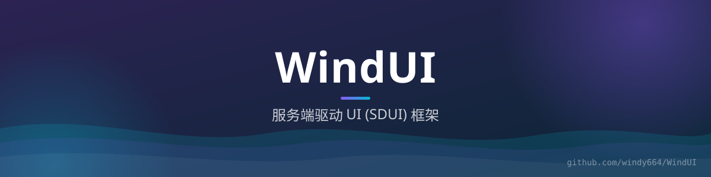

<div align="center">



# WindUI

**服务端驱动 UI（SDUI）框架 for Minecraft** —— 界面用 JSON 定义在服务端，协议化下发、事件化回传，一套 UI 跨 Bukkit / Paper / Velocity / NeoForge 多端渲染。


[架构](#-架构) · [命令](#-命令) · [模块](#-模块)

</div>

## ✨ 是什么

WindUI 把"界面"从插件代码里抽出来：服务端用 JSON 描述界面（`UIJsonParser` + `WidgetNode`），通过协议 payload 下发到客户端渲染；玩家操作以事件回传，服务端经 `GuiEventBus` 分发处理。客户端渲染由 ModernUI 客户端 Mod 承担（WebSocket 通道，默认端口 `25599`），服务端各平台只做宿主适配。

- **协议层**：`UiPayload` / `PatchCodec` / `EventCodec` / `HudCodec` / `AssetCodec` / `ControlCodec`，界面、增量补丁、事件、HUD、资源、控制分通道编码
- **占位符**：`PlaceholderResolver` 在服务端解析 `%...%` 变量再下发
- **HUD**：除 GUI 外支持常驻 HUD 元素（客户端 `HudRenderer` / `HudCanvas`）
- **多平台宿主**：Bukkit（1.16+）、Paper（26.x+）、Velocity、NeoForge（1.21.1 / 26.1.2）均可加载

## 📜 命令

| 命令 | 说明 |
|------|------|
| `/windui open <界面> [玩家]` | 为玩家打开指定界面 |
| `/windui hud` | HUD 相关操作 |
| `/windui list` | 列出已注册界面 |
| `/windui reload` | 重载界面定义 |
| `/windui status` | 查看连接与协议状态 |

## 🧱 模块

| 模块 | 职责 |
|------|------|
| `core` | 平台无关核心：JSON 解析、协议编解码、占位符、GUI/HUD 注册表与事件总线 |
| `server_core` | 服务端公共实现 |
| `bukkit` / `paper` | Bukkit（1.16+）/ Paper（26.x+）宿主插件 |
| `velocity` | Velocity 代理端宿主 |
| `neoforge_1_21_1` / `neoforge_26_1_2` | NeoForge 宿主适配 |
| `client_modernui` | ModernUI 客户端 Mod：WebSocket 客户端与 GUI/HUD 渲染 |

## 🔨 构建

```bash
./gradlew build
```
